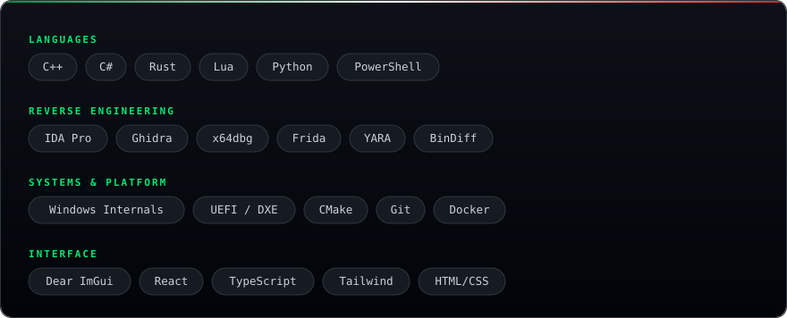

  

 

---

<h3 align="center">Connect With Me</h3>

  
  
  

  discord <code>917198328956084264</code> &nbsp;·&nbsp; telegram <code>@overhaze</code>

 

---

<h3 align="center">Tech Stack &amp; Tools</h3>

  

 

---

<h3 align="center">GitHub Stats</h3>

  
  &nbsp;&nbsp;
  

  

 

---

<h3 align="center">Contribution Activity</h3>

  <picture>
    <source
      media="(prefers-color-scheme: dark)"
      srcset="https://raw.githubusercontent.com/meow4ever/meow4ever/pacman-output/pacman-contribution-graph-dark.svg"
    />
    <source
      media="(prefers-color-scheme: light)"
      srcset="https://raw.githubusercontent.com/meow4ever/meow4ever/pacman-output/pacman-contribution-graph.svg"
    />
    
  </picture>

 

---

<h3 align="center">About</h3>

  I take software apart. Firmware, game clients, drivers, whatever ships as a black box — 
  I want the symbols, the call graph, and the reason it was written that way. 
   
  Most of what I build lives below the abstraction layer: memory layouts, syscalls, hand-rolled parsers, 
  structures recovered from nothing but a debugger and patience.

 

---

  <i>"Il codice non mente. Solo a chi non lo legge."</i>

  

